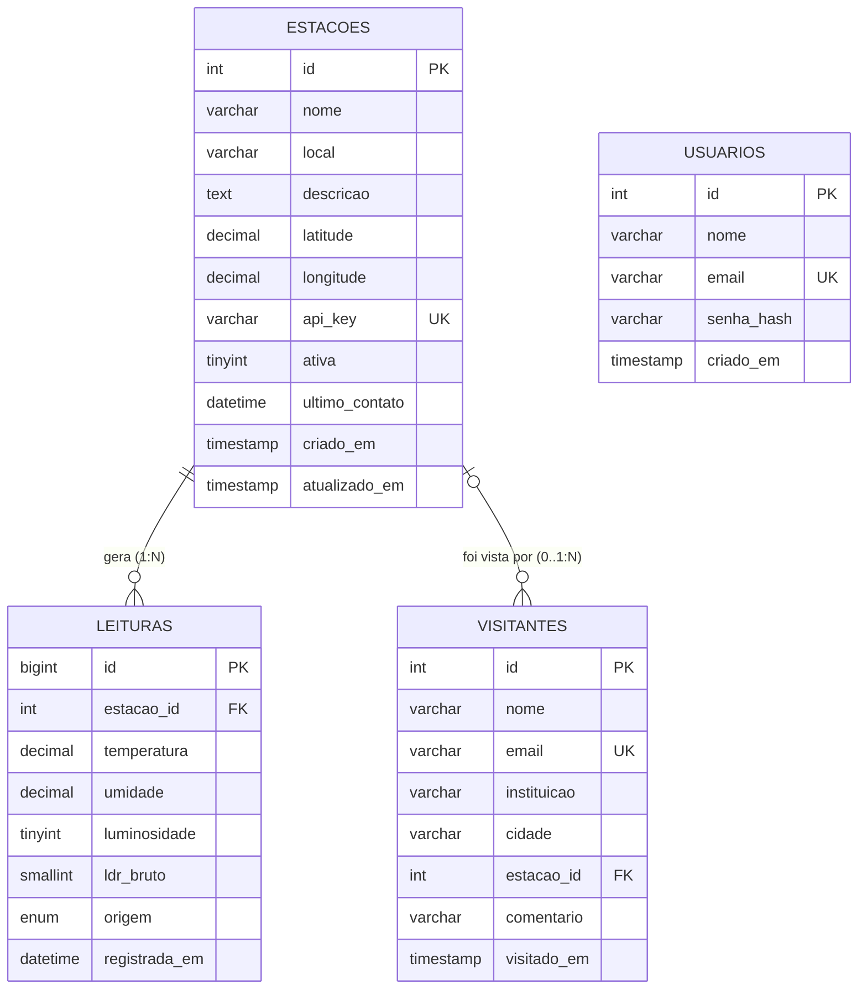

# Modelo Lógico do Banco de Dados

Banco: **estacao_solar** (MySQL/MariaDB, InnoDB, utf8mb4).
Script comentado de criação: [`schema.sql`](schema.sql) · Dados de exemplo: [`seed.sql`](seed.sql)

## Diagrama Entidade-Relacionamento

## Dicionário de dados (resumo)

| Tabela | Papel | Chaves / regras principais |
|---|---|---|
| `usuarios` | Administradores do painel | `email` único; senha guardada como hash bcrypt |
| `estacoes` | Dispositivos ESP32 cadastrados | `api_key` única (credencial do ESP32); `ativa` liga/desliga o recebimento |
| `leituras` | Medições (DHT22 + LDR) | FK `estacao_id` → `estacoes` **ON DELETE CASCADE**; CHECKs: temp −40..80, umid 0..100, luz 0..100; índice `(estacao_id, registrada_em)` |
| `visitantes` | Cadastro da Feira | `email` único; FK `estacao_id` → `estacoes` **ON DELETE SET NULL** (opcional) |

## Relacionamentos

* **estacoes 1 — N leituras**: uma estação gera muitas leituras. Se a estação é excluída, as leituras vão junto (`CASCADE`).
* **estacoes 1 — N visitantes** (opcional): o visitante informa qual estação viu. Se a estação é excluída, o visitante permanece, com `estacao_id = NULL` (`SET NULL`).
* `usuarios` é independente (só controla o acesso ao painel).

## Normalização

Todas as tabelas estão na **3ª Forma Normal**: cada coluna depende apenas da chave primária da sua tabela (o nome da estação não é repetido nas leituras; é buscado por `JOIN`).
