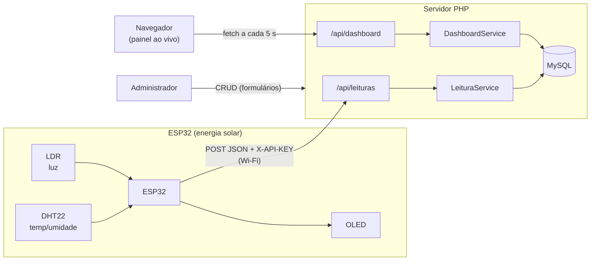
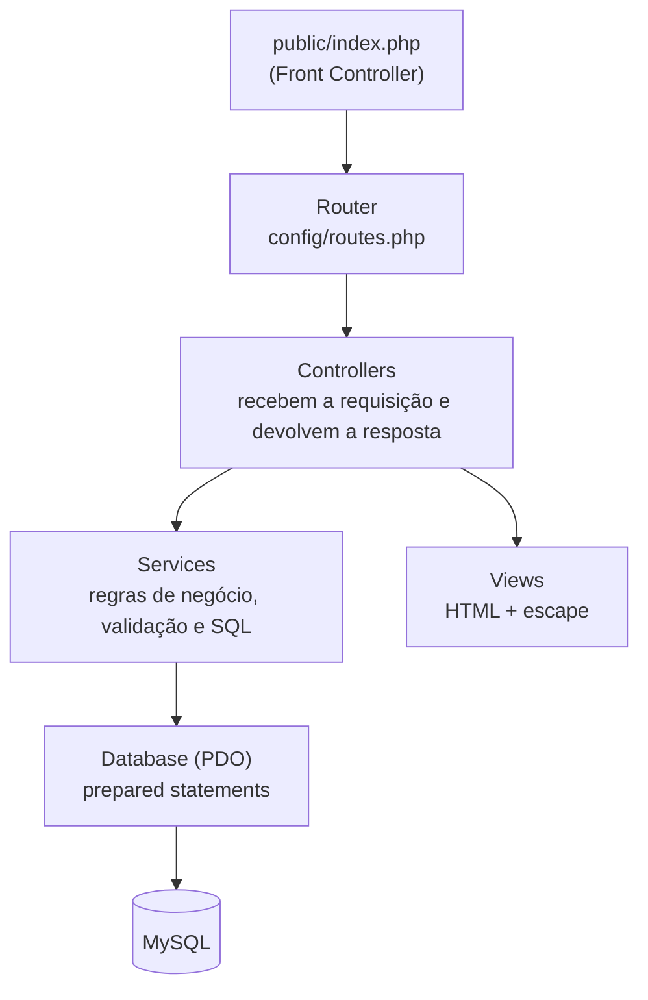
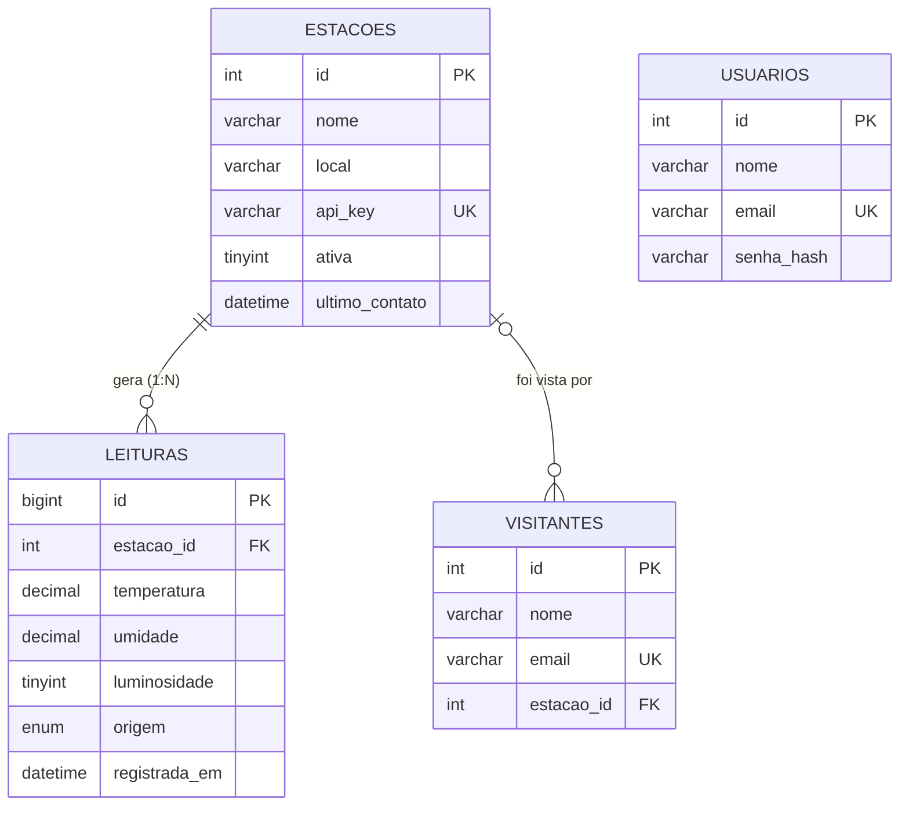

[README (2).md](https://github.com/user-attachments/files/34214511/README.2.md)
# ☀️ Estação Meteorológica Solar IoT

Sistema web completo (PHP + MySQL) para a **Feira Tecnológica**, integrado a um dispositivo IoT real: uma **estação meteorológica alimentada por energia solar** baseada em ESP32. O dispositivo mede temperatura, umidade e luminosidade e envia os dados por Wi-Fi para o site, que armazena, exibe em tempo real e permite gerenciar tudo (CRUD).

> **Equipe:** David Pedreira, Gabriel Ortega, Caio Novaes, Giulio Pimentel· **Turma/Curso:** 2 DS/AMS
> **🎥 Vídeo de apresentação:** _[https://www.youtube.com/watch?v=2fCWTA0aHSQ]

---

## 📑 Sumário
1. [Visão geral](#-visão-geral)
2. [Prints do projeto](#-prints-do-projeto)
3. [Hardware (dispositivo IoT)](#-hardware-dispositivo-iot)
4. [Arquitetura em serviços](#-arquitetura-em-serviços)
5. [Banco de dados e modelo lógico](#-banco-de-dados-e-modelo-lógico)
6. [Operações CRUD](#-operações-crud)
7. [API REST](#-api-rest)
8. [Código comentado: o caminho de uma leitura](#-código-comentado-o-caminho-de-uma-leitura)
9. [Segurança](#-segurança)
10. [Requisitos e como executar](#-requisitos-e-como-executar)
11. [Solução de problemas](#-solução-de-problemas)
12. [Testes realizados](#-testes-realizados)
13. [Estrutura de pastas](#-estrutura-de-pastas)

---

## 🔎 Visão geral

| Item | Descrição |
|---|---|
| **Tema** | Estação meteorológica solar (dispositivo IoT da Feira Tecnológica) |
| **Linguagem / BD** | PHP 8.0+ (sem framework) · MySQL/MariaDB |
| **Arquitetura** | Baseada em **serviços**: `Controller → Service → Banco` + API REST |
| **Entidades com CRUD completo** | **Estações**, **Leituras** e **Visitantes** (3, o mínimo pedido são 2) |
| **Tempo real** | O painel consulta a API a cada 5 s e atualiza cards e gráficos (Chart.js) |
| **Extras** | Login de administrador, status online/offline da estação, filtros, busca, paginação, simulador do ESP32, Docker |

### Fluxo de dados



---

## 📸 Prints do projeto

### Painel ao vivo (página inicial)
Cards com a última leitura, estatísticas das últimas 24 h, status online/offline e gráficos que se atualizam sozinhos a cada 5 s.


### Gerenciamento de estações (CRUD)
Lista com status, total de leituras e os botões **Ver / Editar / Excluir**.


### Detalhe da estação e configuração do ESP32
Mostra os dados da estação e a **chave de API** que o dispositivo usa para enviar as leituras.


### Cadastro público de visitantes
Formulário aberto a qualquer visitante da feira, com validação (nome e e-mail obrigatórios, e-mail único).


### Banco de dados no phpMyAdmin
As 4 tabelas do modelo lógico (`estacoes`, `leituras`, `usuarios`, `visitantes`) em InnoDB, utf8mb4.


<!--
  ⏳ PRINTS PENDENTES: salve os arquivos em docs/img/ com estes nomes e remova as marcas de comentário.

### Lista de leituras (CRUD)


### Lista de visitantes (área administrativa)


### Dispositivo montado

-->

---

## 🔌 Hardware (dispositivo IoT)

| Componente | Função | Pino do ESP32 |
|---|---|---|
| ESP32 (HiLetgo) | Microcontrolador com Wi-Fi | — |
| DHT22 | Temperatura e umidade | GPIO 4 |
| LDR + resistor (divisor de tensão) | Luminosidade | GPIO 34 (ADC1) |
| Display OLED SSD1306 128×64 | Mostra as leituras localmente | SDA 21 / SCL 22 (I²C, 0x3C) |
| Painel solar 6 V + diodo + módulo MT3608 | Carrega e alimenta | — |
| Bateria 18650 + suporte | Armazena energia | — |

* Esquema de ligação (Fritzing): pasta [`hardware/`](hardware/) (arquivo `esp32-hmc5883l.fz`).
* Firmware: [`firmware/estacao_solar/estacao_solar.ino`](firmware/estacao_solar/estacao_solar.ino) — lê os sensores, mostra no OLED e envia um `POST` JSON a cada 10 s.

---

## 🧱 Arquitetura em serviços

Cada camada tem **uma única responsabilidade**. O controller nunca escreve SQL; o service nunca desenha HTML.



| Camada | Pasta | Responsabilidade |
|---|---|---|
| **Core** | `src/Core` | Router, Request, Response, View, Auth (sessão + CSRF), Database (PDO) |
| **Controllers** | `src/Controllers` | Páginas web (`EstacaoController`…) e API (`src/Controllers/Api`) |
| **Services** | `src/Services` | `EstacaoService`, `LeituraService`, `VisitanteService`, `DashboardService` |
| **Views** | `views/` | Telas em PHP/HTML |
| **Support** | `src/Support` | Validação e funções auxiliares |

> O **mesmo Service** atende a página web e a API REST — a regra de negócio existe uma vez só.

---

## 🗄️ Banco de dados e modelo lógico

* **Script comentado:** [`database/schema.sql`](database/schema.sql) · **Dados de exemplo:** [`database/seed.sql`](database/seed.sql)
* **Modelo lógico completo e dicionário de dados:** [`database/MODELO_LOGICO.md`](database/MODELO_LOGICO.md)



Destaques: chaves estrangeiras (`CASCADE` em leituras, `SET NULL` em visitantes), `CHECK` nos limites dos sensores, índice composto `(estacao_id, registrada_em)` e e-mail único.

---

## ✅ Operações CRUD

| Entidade | Create | Read | Update | Delete |
|---|---|---|---|---|
| **Estações** | `POST /estacoes` | `GET /estacoes`, `GET /estacoes/{id}` | `POST /estacoes/{id}/atualizar` | `POST /estacoes/{id}/excluir` |
| **Leituras** | `POST /leituras` (manual) · `POST /api/leituras` (ESP32) | `GET /leituras` (filtro + paginação) | `POST /leituras/{id}/atualizar` | `POST /leituras/{id}/excluir` |
| **Visitantes** | `POST /visitantes` (público) | `GET /visitantes` (busca + paginação) | `POST /visitantes/{id}/atualizar` | `POST /visitantes/{id}/excluir` |

As mesmas operações existem na API REST com os verbos `POST / GET / PUT / DELETE` (abaixo). O mapa completo de rotas está comentado em [`config/routes.php`](config/routes.php).

---

## 🌐 API REST

Base: `http://SEU_SERVIDOR/api` · Respostas em JSON · Erros: `401` (sem login/chave), `404`, `422` (validação, com os campos), `405`.

| Método | Rota | Acesso | Descrição |
|---|---|---|---|
| `POST` | `/api/leituras` | **Chave da estação** (`X-API-KEY`) | O ESP32 envia uma leitura |
| `GET` | `/api/leituras?estacao_id=1&pagina=1` | Público | Lista leituras |
| `GET` | `/api/leituras/{id}` | Público | Detalhe |
| `PUT` | `/api/leituras/{id}` | Admin | Atualiza |
| `DELETE` | `/api/leituras/{id}` | Admin | Exclui |
| `GET` | `/api/estacoes` · `/api/estacoes/{id}` | Público | Lista / detalhe (sem a `api_key`) |
| `POST` `PUT` `DELETE` | `/api/estacoes[/{id}]` | Admin | Cria / atualiza / exclui |
| `POST` | `/api/visitantes` | Público | Cadastra visitante |
| `GET` `PUT` `DELETE` | `/api/visitantes[/{id}]` | Admin | Lista / atualiza / exclui |
| `GET` | `/api/dashboard?estacao=1` | Público | Dados do painel (última leitura, estatísticas 24 h, séries) |
| `POST` | `/api/login` | — | Login por JSON (para testes no Postman/curl) |

**Exemplo — o que o ESP32 envia:**
```bash
curl -X POST http://localhost:8000/api/leituras \
  -H "Content-Type: application/json" \
  -H "X-API-KEY: estacao-solar-demo-0001" \
  -d '{"temperatura":27.4,"umidade":55.2,"luminosidade":80,"ldr_bruto":3300}'
# -> 201 Created
```

---

## 🧭 Código comentado: o caminho de uma leitura

Para entender o sistema, acompanhe o que acontece quando o ESP32 envia **uma leitura** (trechos reais do projeto, resumidos).

### 1️⃣ O ESP32 envia os dados — `firmware/estacao_solar/estacao_solar.ino`
```cpp
// Monta o JSON com as medidas dos sensores
snprintf(json, sizeof(json),
  "{\"temperatura\":%.1f,\"umidade\":%.1f,\"luminosidade\":%d,\"ldr_bruto\":%d}",
  temp, umid, luzPct, ldrBruto);

http.begin(SERVER_URL);                         // endereço da API
http.addHeader("Content-Type", "application/json");
http.addHeader("X-API-KEY", API_KEY);           // "senha" da estação
int codigo = http.POST(json);                   // 201 = leitura gravada
```

### 2️⃣ O Router escolhe quem atende — `config/routes.php`
```php
// POST /api/leituras  ->  ApiLeituraController::receber  (sem login: usa a chave da estação)
$r->post('/api/leituras', [ApiLeituraController::class, 'receber']);
```

### 3️⃣ O Controller valida a chave — `src/Controllers/Api/ApiLeituraController.php`
```php
$chave = $req->header('x-api-key');                    // lê o cabeçalho enviado pelo ESP32
$est   = $estacoes->buscarPorChave($chave);            // procura a estação dona da chave
if (!$est) throw new HttpException(401, 'Chave de API inválida.');

// A estação vem da CHAVE, nunca do corpo: o dispositivo não pode "falar por outra estação"
$id = $this->svc->criar(['estacao_id' => $est['id']] + $req->body, 'esp32');
$estacoes->registrarContato((int) $est['id']);         // marca a estação como "online"
```
O controller **não tem SQL**: ele só recebe, confere a credencial e delega ao Service.

### 4️⃣ O Service aplica as regras e grava — `src/Services/LeituraService.php`
```php
public function criar(array $in, string $origem = 'manual'): int
{
    $d = $this->validar($in, true);   // temperatura -40..80, umidade 0..100, luz 0..100...
    DB::run(                          // prepared statement: protege contra SQL Injection
        'INSERT INTO leituras (estacao_id, temperatura, umidade, luminosidade, ldr_bruto, origem, registrada_em)
         VALUES (:estacao_id, :temperatura, :umidade, :luminosidade, :ldr_bruto, :origem, COALESCE(:registrada_em, NOW()))',
        $d
    );
    return DB::lastId();
}
```
Se algum valor for inválido, o Service lança `ValidationException` e a API responde **422** com o campo errado.

### 5️⃣ O painel mostra em tempo real — `public/assets/js/dashboard.js`
```js
// A cada 5 segundos o navegador pergunta à API pelos dados mais recentes...
const r = await fetch(`${BASE}/api/dashboard?estacao=${estacao}`);
const d = await r.json();
$('v-temp').textContent = fmt(d.ultima.temperatura);   // ...atualiza os cards
preencher(gTemp, d.serie.labels, d.serie.temperatura); // ...e os gráficos (Chart.js)
setInterval(atualizar, 5000);                          // sem recarregar a página
```
> **"Tempo real" aqui = _polling_:** o navegador consulta a cada 5 s. É simples, robusto e suficiente para uma estação meteorológica.

### Resumo do caminho
```
ESP32 ─POST JSON─▶ Router ─▶ ApiLeituraController ─▶ LeituraService ─▶ MySQL
                                                                         │
Navegador ◀── JSON ── ApiDashboardController ◀── DashboardService ◀──────┘
```

---

## 🔒 Segurança

| Risco | Proteção aplicada | Onde |
|---|---|---|
| SQL Injection | *Prepared statements* (PDO) em **todas** as consultas | `src/Core/Database.php` |
| XSS | `htmlspecialchars` (função `e()`) em toda saída | `views/`, `helpers.php` |
| CSRF | Token por sessão em todo formulário `POST` | `Auth.php`, `Router.php` |
| Senhas | `password_hash` / `password_verify` (bcrypt) | `Auth.php` |
| Fixação de sessão | `session_regenerate_id` no login; cookie `HttpOnly` + `SameSite=Lax` | `Auth.php` |
| Dispositivo falso | Cada estação tem `api_key` própria; a estação é definida **pela chave**, não pelo corpo | `ApiLeituraController` |
| Dados inválidos | Validação no Service **e** `CHECK` no banco | `Services/`, `schema.sql` |

---

## 🚀 Requisitos e como executar

| Requisito | Versão |
|---|---|
| PHP | **8.0 ou superior** (extensões `pdo_mysql`, `mbstring` e `json`; no XAMPP já vêm ativas) |
| MySQL / MariaDB | MySQL 8+ ou MariaDB 10.5+ |
| Servidor web | Apache (XAMPP) ou o servidor embutido do PHP |
| Hardware | ESP32 + DHT22 + LDR + OLED SSD1306 (opcional: há simulador) |
| Arduino IDE | Com suporte à placa ESP32 e as bibliotecas citadas abaixo |


### Opção A — XAMPP (Windows)
1. Instale o [XAMPP](https://www.apachefriends.org) e inicie **Apache** e **MySQL**.
2. Copie a pasta do projeto para `C:\xampp\htdocs\estacao-solar-iot`.
3. Abra `http://localhost/phpmyadmin` → aba **Importar** → importe `database/schema.sql` e depois `database/seed.sql`.
4. Na pasta do projeto, copie `.env.example` para `.env` (no Prompt: `copy .env.example .env`). No XAMPP o padrão `root` sem senha já funciona.
5. Acesse **http://localhost/estacao-solar-iot/** (não precisa digitar `/public`: o `.htaccess` da raiz redireciona).

### Opção B — Docker
```bash
docker compose up --build
```
Site em **http://localhost:8080** · phpMyAdmin em http://localhost:8081 (banco e dados de exemplo já criados automaticamente).

### Opção C — Servidor embutido do PHP
```bash
mysql -u root -p < database/schema.sql
mysql -u root -p < database/seed.sql
cp .env.example .env        # ajuste DB_USER / DB_PASS
php -S 0.0.0.0:8000 -t public public/index.php
```
Site em **http://localhost:8000**

**Login de administrador (demonstração):** `admin@feira.com` / `admin123` — *troque antes de publicar de verdade.*

### Conectando o ESP32
1. Na Arduino IDE instale: *Adafruit GFX*, *Adafruit SSD1306*, *DHT sensor library* e *Adafruit Unified Sensor*.
2. Em `firmware/estacao_solar/`, copie `config.h.example` → `config.h` e preencha Wi-Fi, `SERVER_URL` (use o **IP do computador** na rede) e `API_KEY` (a chave aparece em **Estações → Ver**).
3. Grave no ESP32, abra o Monitor Serial (115200): deve aparecer `HTTP 201` a cada envio.
4. Abra o painel: a estação fica **online** e os gráficos andam sozinhos.

> Sem o hardware à mão? Rode o simulador: `php tools/simular_esp32.php http://localhost:8000/api/leituras estacao-solar-demo-0001 20 2`

---

## 🛠️ Solução de problemas

| Sintoma | Causa provável | Solução |
|---|---|---|
| Abre "Index of /" listando pastas | Acessou `http://localhost/` | Acesse `http://localhost/estacao-solar-iot/` |
| XAMPP: *MySQL shutdown unexpectedly* | Porta **3306 ocupada** por outro MySQL do Windows | `netstat -ano \| findstr :3306` para achar o processo; pare o serviço (`net stop NOME_DO_SERVICO`) ou mude a porta do XAMPP para 3307 e ajuste `DB_PORT` no `.env` |
| Erro de conexão com o banco | MySQL desligado ou `.env` ausente/errado | Inicie o MySQL e confira o `.env` (`DB_USER=root`, `DB_PASS=` vazio no XAMPP) |
| `Unknown database 'estacao_solar'` | Banco não importado | Importe `schema.sql` e depois `seed.sql` no phpMyAdmin |
| Acentos estranhos (`Estação`) | Importação sem UTF-8 | Reimporte os dois `.sql` (já têm `SET NAMES utf8mb4`) |
| Erro 404 em todas as páginas | `mod_rewrite` desligado | No `httpd.conf`, ative `LoadModule rewrite_module ...` e use `AllowOverride All` |
| ESP32 mostra `HTTP -1` | ESP32 não alcança o PC | Mesma rede Wi-Fi, IP correto no `SERVER_URL`, liberar o Apache no Firewall do Windows |
| ESP32 mostra `HTTP 401` | `API_KEY` errada | Copie a chave em **Estações → Ver** |
| ESP32 não conecta ao Wi-Fi | Rede de 5 GHz | O ESP32 só usa Wi-Fi de **2,4 GHz** |
| Estação sempre "offline" | Sem dados há mais de 2 min | Confirme o envio no Monitor Serial; o limite é `ESTACAO_OFFLINE_MIN` no `.env` |

---

## 🧪 Testes realizados

Durante o desenvolvimento foram verificados, com banco MariaDB real:

* **API:** envio do ESP32 com chave válida (201), sem chave (401), chave inválida (401), valor fora do limite (422); criar/ler/atualizar/excluir de estações, leituras e visitantes; bloqueio de escrita sem login (401); registro inexistente (404).
* **Páginas web:** login (certo, errado e sem token CSRF), CRUD completo das 3 entidades pelos formulários, validação de campos, e-mail duplicado, filtro por estação, busca, paginação, escape de HTML (tentativa de XSS) e bloqueio de exclusão sem token CSRF.
* **Simulador:** `tools/simular_esp32.php` enviando leituras e a estação mudando para *online*.

> O firmware do ESP32 e a execução no Docker devem ser conferidos no equipamento real da equipe.

---

## 📁 Estrutura de pastas

```
estacao-solar-iot/
├── config/            config.php (lê .env) e routes.php (mapa de rotas)
├── database/          schema.sql · seed.sql · MODELO_LOGICO.md
├── docs/              roteiro do vídeo, checklist e prints (docs/img)
├── firmware/          código do ESP32 (.ino) + config.h.example
├── hardware/          esquema Fritzing (.fz) e peças
├── public/            index.php (front controller), css, js, Chart.js
├── src/
│   ├── Core/          Router, Request, Response, View, Auth, Database
│   ├── Controllers/   páginas web  +  Api/ (REST)
│   ├── Services/      Estacao / Leitura / Visitante / Dashboard
│   └── Support/       Validacao e helpers
├── tools/             simulador do ESP32
├── views/             templates HTML
├── Dockerfile · docker-compose.yml
└── README.md
```

---

## 📝 Licença
Projeto acadêmico desenvolvido para a Feira Tecnológica. Uso livre para fins educacionais.
