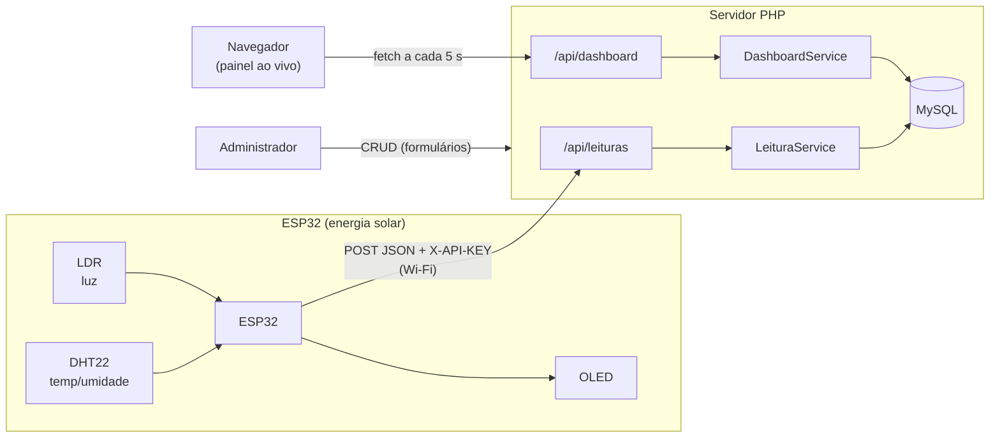
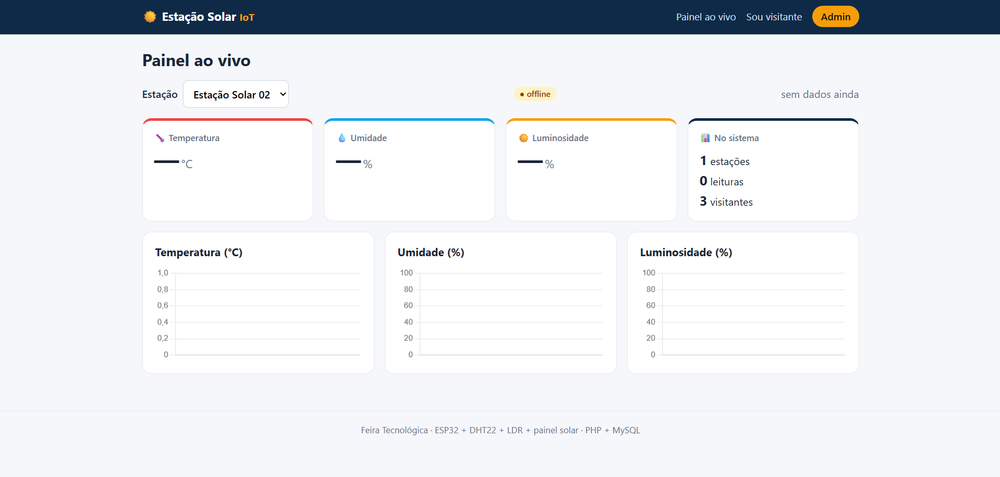
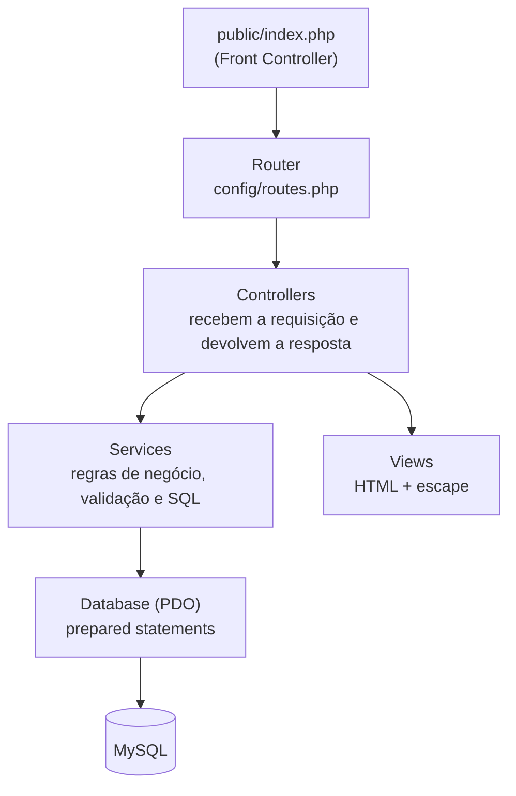
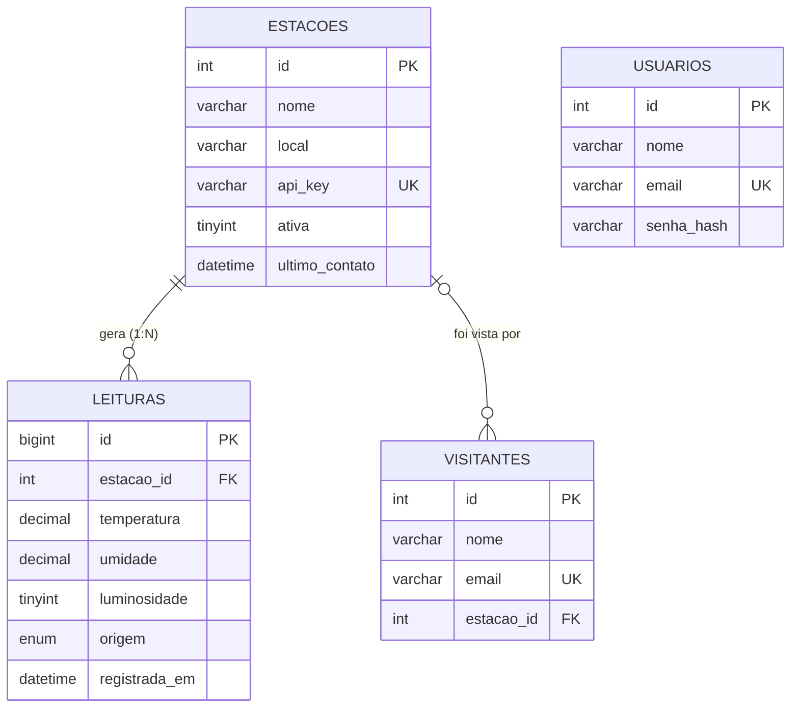

# ☀️ Estação Meteorológica Solar IoT

Sistema web completo (PHP + MySQL) para a **Feira Tecnológica**, integrado a um dispositivo IoT real: uma **estação meteorológica alimentada por energia solar** baseada em ESP32. O dispositivo mede temperatura, umidade e luminosidade e envia os dados por Wi-Fi para o site, que armazena, exibe em tempo real e permite gerenciar tudo (CRUD).

> **Equipe:** _Nome 1, Nome 2, Nome 3, Nome 4, Nome 5_ · **Turma/Curso:** _preencher_
> **🎥 Vídeo de apresentação:** _[colar o link do YouTube aqui]_

---

## 📑 Sumário
1. [Visão geral](#-visão-geral)
2. [Prints do projeto](#-prints-do-projeto)
3. [Hardware (dispositivo IoT)](#-hardware-dispositivo-iot)
4. [Arquitetura em serviços](#-arquitetura-em-serviços)
5. [Banco de dados e modelo lógico](#-banco-de-dados-e-modelo-lógico)
6. [Operações CRUD](#-operações-crud)
7. [API REST](#-api-rest)
8. [Segurança](#-segurança)
9. [Como executar](#-como-executar)
10. [Estrutura de pastas](#-estrutura-de-pastas)

---

## 🔎 Visão geral

| Item | Descrição |
|---|---|
| **Tema** | Estação meteorológica solar (dispositivo IoT da Feira Tecnológica) |
| **Linguagem / BD** | PHP 8 (sem framework) · MySQL/MariaDB |
| **Arquitetura** | Baseada em **serviços**: `Controller → Service → Banco` + API REST |
| **Entidades com CRUD completo** | **Estações**, **Leituras** e **Visitantes** (3, o mínimo pedido são 2) |
| **Tempo real** | O painel consulta a API a cada 5 s e atualiza cards e gráficos (Chart.js) |
| **Extras** | Login de administrador, status online/offline da estação, filtros, busca, paginação, simulador do ESP32, Docker |

### Fluxo de dados



---

## 📸 Prints do projeto

> ⚠️ **Substitua** os arquivos em `docs/img/` pelos prints reais (veja [`docs/CHECKLIST_ENTREGA.md`](docs/CHECKLIST_ENTREGA.md)).

| Painel ao vivo | Estações |
|---|---|
|  |  |
| **Detalhe da estação (chave da API)** | **Leituras** |
|  |  |
| **Visitantes (admin)** | **Cadastro público de visitante** |
|  |  |
| **Dispositivo montado** | **Banco no phpMyAdmin** |
|  |  |

---

## 🔌 Hardware (dispositivo IoT)

| Componente | Função | Pino do ESP32 |
|---|---|---|
| ESP32 (HiLetgo) | Microcontrolador com Wi-Fi | — |
| DHT22 | Temperatura e umidade | GPIO 4 |
| LDR + resistor (divisor de tensão) | Luminosidade | GPIO 34 (ADC1) |
| Display OLED SSD1306 128×64 | Mostra as leituras localmente | SDA 21 / SCL 22 (I²C, 0x3C) |
| Painel solar 6 V + diodo + módulo MT3608 | Carrega e alimenta | — |
| Bateria 18650 + suporte | Armazena energia | — |

* Esquema de ligação (Fritzing): pasta [`hardware/`](hardware/) (arquivo `esp32-hmc5883l.fz`).
* Firmware: [`firmware/estacao_solar/estacao_solar.ino`](firmware/estacao_solar/estacao_solar.ino) — lê os sensores, mostra no OLED e envia um `POST` JSON a cada 10 s.

---

## 🧱 Arquitetura em serviços

Cada camada tem **uma única responsabilidade**. O controller nunca escreve SQL; o service nunca desenha HTML.



| Camada | Pasta | Responsabilidade |
|---|---|---|
| **Core** | `src/Core` | Router, Request, Response, View, Auth (sessão + CSRF), Database (PDO) |
| **Controllers** | `src/Controllers` | Páginas web (`EstacaoController`…) e API (`src/Controllers/Api`) |
| **Services** | `src/Services` | `EstacaoService`, `LeituraService`, `VisitanteService`, `DashboardService` |
| **Views** | `views/` | Telas em PHP/HTML |
| **Support** | `src/Support` | Validação e funções auxiliares |

> O **mesmo Service** atende a página web e a API REST — a regra de negócio existe uma vez só.

---

## 🗄️ Banco de dados e modelo lógico

* **Script comentado:** [`database/schema.sql`](database/schema.sql) · **Dados de exemplo:** [`database/seed.sql`](database/seed.sql)
* **Modelo lógico completo e dicionário de dados:** [`database/MODELO_LOGICO.md`](database/MODELO_LOGICO.md)



Destaques: chaves estrangeiras (`CASCADE` em leituras, `SET NULL` em visitantes), `CHECK` nos limites dos sensores, índice composto `(estacao_id, registrada_em)` e e-mail único.

---

## ✅ Operações CRUD

| Entidade | Create | Read | Update | Delete |
|---|---|---|---|---|
| **Estações** | `POST /estacoes` | `GET /estacoes`, `GET /estacoes/{id}` | `POST /estacoes/{id}/atualizar` | `POST /estacoes/{id}/excluir` |
| **Leituras** | `POST /leituras` (manual) · `POST /api/leituras` (ESP32) | `GET /leituras` (filtro + paginação) | `POST /leituras/{id}/atualizar` | `POST /leituras/{id}/excluir` |
| **Visitantes** | `POST /visitantes` (público) | `GET /visitantes` (busca + paginação) | `POST /visitantes/{id}/atualizar` | `POST /visitantes/{id}/excluir` |

As mesmas operações existem na API REST com os verbos `POST / GET / PUT / DELETE` (abaixo). O mapa completo de rotas está comentado em [`config/routes.php`](config/routes.php).

---

## 🌐 API REST

Base: `http://SEU_SERVIDOR/api` · Respostas em JSON · Erros: `401` (sem login/chave), `404`, `422` (validação, com os campos), `405`.

| Método | Rota | Acesso | Descrição |
|---|---|---|---|
| `POST` | `/api/leituras` | **Chave da estação** (`X-API-KEY`) | O ESP32 envia uma leitura |
| `GET` | `/api/leituras?estacao_id=1&pagina=1` | Público | Lista leituras |
| `GET` | `/api/leituras/{id}` | Público | Detalhe |
| `PUT` | `/api/leituras/{id}` | Admin | Atualiza |
| `DELETE` | `/api/leituras/{id}` | Admin | Exclui |
| `GET` | `/api/estacoes` · `/api/estacoes/{id}` | Público | Lista / detalhe (sem a `api_key`) |
| `POST` `PUT` `DELETE` | `/api/estacoes[/{id}]` | Admin | Cria / atualiza / exclui |
| `POST` | `/api/visitantes` | Público | Cadastra visitante |
| `GET` `PUT` `DELETE` | `/api/visitantes[/{id}]` | Admin | Lista / atualiza / exclui |
| `GET` | `/api/dashboard?estacao=1` | Público | Dados do painel (última leitura, estatísticas 24 h, séries) |
| `POST` | `/api/login` | — | Login por JSON (para testes no Postman/curl) |

**Exemplo — o que o ESP32 envia:**
```bash
curl -X POST http://localhost:8000/api/leituras \
  -H "Content-Type: application/json" \
  -H "X-API-KEY: estacao-solar-demo-0001" \
  -d '{"temperatura":27.4,"umidade":55.2,"luminosidade":80,"ldr_bruto":3300}'
# -> 201 Created
```

---

## 🔒 Segurança

| Risco | Proteção aplicada | Onde |
|---|---|---|
| SQL Injection | *Prepared statements* (PDO) em **todas** as consultas | `src/Core/Database.php` |
| XSS | `htmlspecialchars` (função `e()`) em toda saída | `views/`, `helpers.php` |
| CSRF | Token por sessão em todo formulário `POST` | `Auth.php`, `Router.php` |
| Senhas | `password_hash` / `password_verify` (bcrypt) | `Auth.php` |
| Fixação de sessão | `session_regenerate_id` no login; cookie `HttpOnly` + `SameSite=Lax` | `Auth.php` |
| Dispositivo falso | Cada estação tem `api_key` própria; a estação é definida **pela chave**, não pelo corpo | `ApiLeituraController` |
| Dados inválidos | Validação no Service **e** `CHECK` no banco | `Services/`, `schema.sql` |

---

## 🚀 Como executar

### Opção A — XAMPP (Windows)
1. Instale o [XAMPP](https://www.apachefriends.org) e inicie **Apache** e **MySQL**.
2. Copie a pasta do projeto para `C:\xampp\htdocs\estacao-solar-iot`.
3. Abra `http://localhost/phpmyadmin` → aba **Importar** → importe `database/schema.sql` e depois `database/seed.sql`.
4. Copie `.env.example` para `.env` (no XAMPP o padrão `root` sem senha já funciona).
5. Acesse **http://localhost/estacao-solar-iot/**

### Opção B — Docker
```bash
docker compose up --build
```
Site em **http://localhost:8080** · phpMyAdmin em http://localhost:8081 (banco e dados de exemplo já criados automaticamente).

### Opção C — Servidor embutido do PHP
```bash
mysql -u root -p < database/schema.sql
mysql -u root -p < database/seed.sql
cp .env.example .env        # ajuste DB_USER / DB_PASS
php -S 0.0.0.0:8000 -t public public/index.php
```
Site em **http://localhost:8000**

**Login de administrador (demonstração):** `admin@feira.com` / `admin123` — *troque antes de publicar de verdade.*

### Conectando o ESP32
1. Na Arduino IDE instale: *Adafruit GFX*, *Adafruit SSD1306*, *DHT sensor library* e *Adafruit Unified Sensor*.
2. Em `firmware/estacao_solar/`, copie `config.h.example` → `config.h` e preencha Wi-Fi, `SERVER_URL` (use o **IP do computador** na rede) e `API_KEY` (a chave aparece em **Estações → Ver**).
3. Grave no ESP32, abra o Monitor Serial (115200): deve aparecer `HTTP 201` a cada envio.
4. Abra o painel: a estação fica **online** e os gráficos andam sozinhos.

> Sem o hardware à mão? Rode o simulador: `php tools/simular_esp32.php http://localhost:8000/api/leituras estacao-solar-demo-0001 20 2`

---

## 📁 Estrutura de pastas

```
estacao-solar-iot/
├── config/            config.php (lê .env) e routes.php (mapa de rotas)
├── database/          schema.sql · seed.sql · MODELO_LOGICO.md
├── docs/              roteiro do vídeo, checklist e prints (docs/img)
├── firmware/          código do ESP32 (.ino) + config.h.example
├── hardware/          esquema Fritzing (.fz) e peças
├── public/            index.php (front controller), css, js, Chart.js
├── src/
│   ├── Core/          Router, Request, Response, View, Auth, Database
│   ├── Controllers/   páginas web  +  Api/ (REST)
│   ├── Services/      Estacao / Leitura / Visitante / Dashboard
│   └── Support/       Validacao e helpers
├── tools/             simulador do ESP32
├── views/             templates HTML
├── Dockerfile · docker-compose.yml
└── README.md
```

---

## 📝 Licença
Projeto acadêmico desenvolvido para a Feira Tecnológica. Uso livre para fins educacionais.
